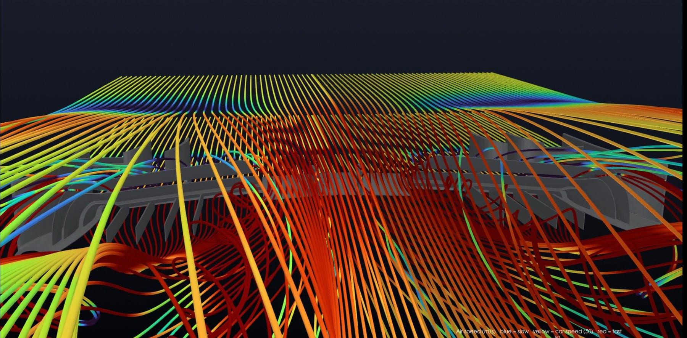
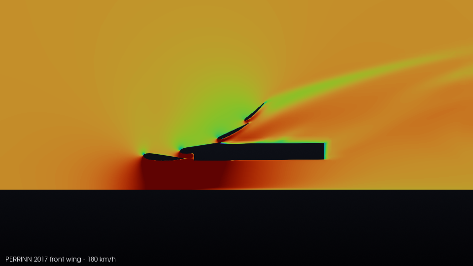
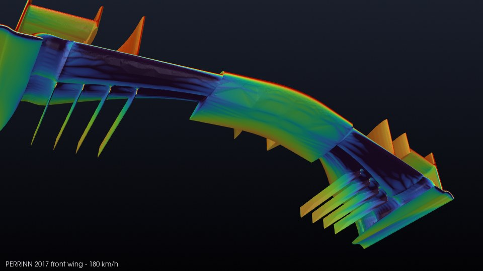
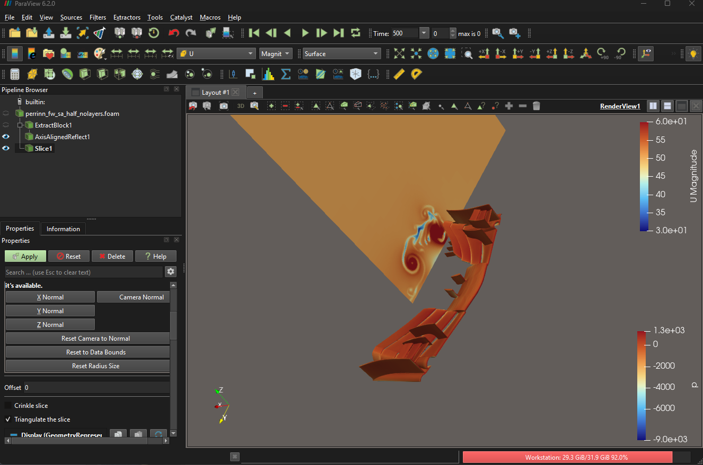
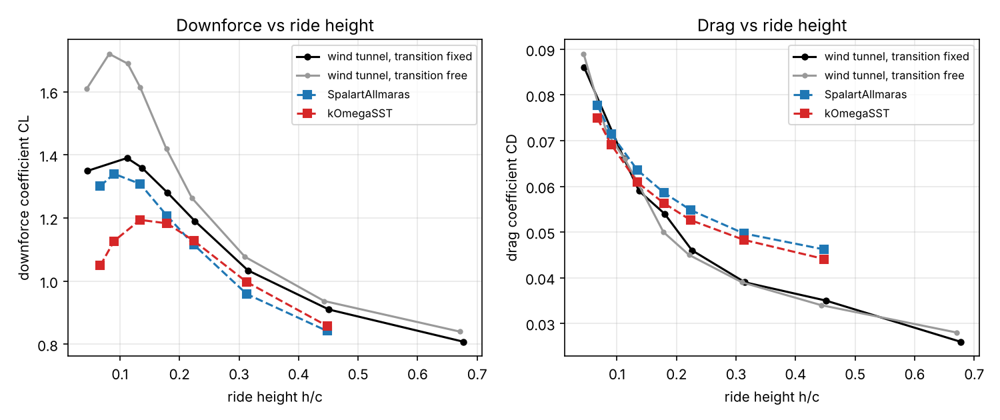
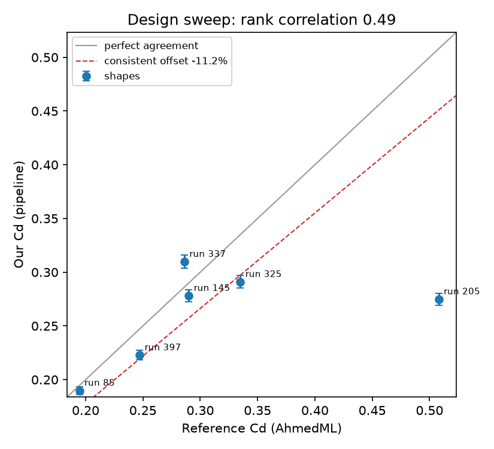
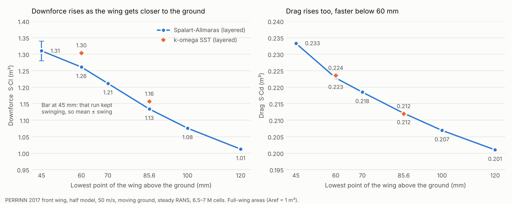
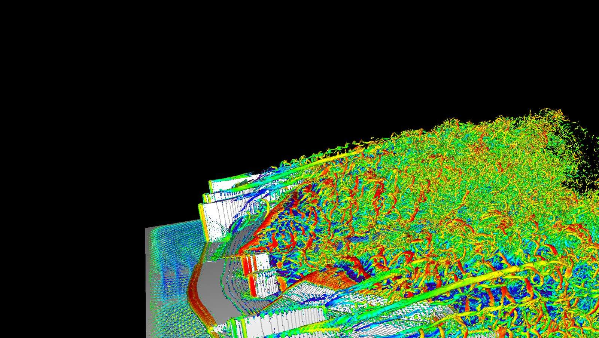
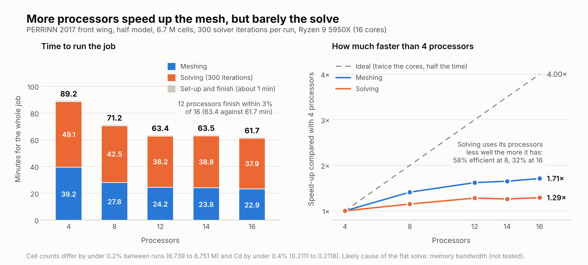

# cfd-pipeline

An automated OpenFOAM job pipeline for external aerodynamics (built for a Formula Student team).
Give it a geometry and a job file; it checks the geometry, builds the case, meshes, solves, checks the
result and writes a summary, stopping at the first thing that looks wrong.

**Status: working research tool, not a finished product.** It has been run on a standard Ahmed body, a
single-element wing in ground effect and a real F1 front wing, but only on those. "Runs reliably on any CAD file"
is the aim, not something demonstrated yet; see [What it cannot do](#what-it-cannot-do-yet).

Two words are used strictly in this README. **Validated** means the result agrees with measurements of the same
configuration. **Verified** means the numerics were checked (mesh independence, consistent trends) but there is no
measured data to compare with.



*Streamlines past the PERRINN 2017 front wing at 180 km/h (50 m/s), drawn by `src/render_flow.py` from a finished case.
Blue is slow, yellow is the car's own speed, red is fast.*

## What a run does

```
geometry (STL/STEP)
  1. inspect     closed surface? units? exports a clean STL in metres
  2. case        builds an OpenFOAM v14 case (half model, ground, refinement boxes, force coefficients)
  3. mesh        snappyHexMesh in parallel
  4. mesh gates  stop if the mesh leaked, failed checkMesh or has too many bad faces
  5. solve       runs in blocks; stops as soon as the mean forces settle, never before min / after max iterations
  6. finish      results.json + summary.md (forces, gate results, stage timings)
```

The checks are the point. A pipeline that always produces a number is dangerous, so each stage can stop the job:

| Gate | What it catches |
|---|---|
| Geometry inspection | open or non-manifold surfaces, flipped faces, unit mistakes, touching solids |
| `FLUID_VOLUME` | air left inside the body (a leaked mesh that otherwise "runs fine") |
| `MESH_QUALITY` | checkMesh failures; isolated skewed faces are a warning, not a failure |
| `CONVERGED` | forces still drifting at the end of the run; reports mean and swing |
| Half-model symmetry | a body edited on one side only (refused above 5% surface-area difference) |

## Quick start

Developed on Ubuntu (WSL2), OpenFOAM Foundation v14, Python 3.12+.

```bash
python3 -m venv .venv && . .venv/bin/activate
pip install -r requirements.txt          # numpy, pytest, matplotlib
pip install cadquery                      # only needed to read STEP files (large install)
python -m pytest -q                       # tests that need CadQuery or OpenFOAM skip themselves
```

Run one job (needs OpenFOAM sourced, `$FOAM_RUN` and `$FOAM_TUTORIALS` set):

```bash
python src/run_job.py job_specs/ahmed1_quick.json --check-only   # validate the job file and environment
python src/run_job.py job_specs/ahmed1_quick.json                # a few minutes: smoke test
```

Run several one after another (a failed job does not stop the batch):

```bash
python src/run_batch.py job_specs/ahmed25_standard.json job_specs/ahmed35_standard.json
```

Each job gets its own folder in `$FOAM_RUN/jobs/<name>_<timestamp>/` with `job.json`, `inspection.json`,
`case/`, `results.json`, `status.json` (stage and timings) and `summary.md`. Exit codes: 0 finished (PASS or WARN),
1 FAIL or stopped by a gate, 2 error.

A job file is JSON: geometry path and units, a preset (`quick`, `standard`, `fine`), optional case overrides
(speed, ground, reference area, processors, turbulence model, mesh levels, half model), solve limits, and an
optional reference CSV. See `job_specs/` for examples, including a ride-height sweep and design-variant tests.

## Tools

| Script | Purpose |
|---|---|
| `src/run_job.py`, `src/run_batch.py` | one job / many jobs, end to end |
| `src/inspect_geometry.py` | pre-flight geometry checker (writes a JSON report with the input's SHA-256) |
| `src/fix_geometry.py` | turns a multi-part STEP assembly into one closed solid, placed on the ground from a CFD box |
| `src/make_case.py`, `src/check_case.py` | case generator and quality gates |
| `src/grid_study.py` | grid-convergence study (Celik et al. 2008: observed order, Richardson extrapolation, GCI) |
| `src/prepare_sweep.py`, `src/analyse_sweep.py` | design sweep against the AhmedML dataset and a ranking analysis |
| `src/compare_lienhart.py`, `src/compare_zerihan.py` | comparison with wind-tunnel data |
| `src/make_ahmed.py`, `src/make_tyrrell_wing.py` | build the Ahmed body and Zerihan wing from published dimensions |
| `src/compare_cores.py` | core-count benchmark: scaling table from finished job folders |
| `src/step_to_fluidx3d.py` | exports a STEP file as one STL per solid, placed for the FluidX3D comparison |
| `src/make_wing_case.py` | early wing case generator, superseded by `make_case.py` and kept for reference |
| `src/render_flow.py` | publication-style pictures and an orbit video from a finished case (ParaView `pvbatch`) |

## Pictures from a finished case

`src/render_flow.py` turns a finished case into website-ready pictures and an orbit video with ParaView. These two
are of the PERRINN front wing at 180 km/h.

| Air speed on a slice through the wing | Pressure on the underside of the wing |
|---|---|
|  |  |
| Red is fast and blue is slow: the air speeds up under the wing and is slowed above the front elements. | Blue is suction (low pressure), the source of the downforce; orange and red are higher pressure. |

The cases are ordinary OpenFOAM cases, so they also open directly in ParaView for anything the scripts do not draw:



*The half-model PERRINN case in ParaView 6.2, mirrored about the symmetry plane, with a slice of air speed behind the
wing and the wing surface coloured by pressure.*

## Validation, and what it does and does not support

- **Validated: single-element wing in ground effect (Zerihan 2001, Southampton wind tunnel, moving ground).**
  Spalart-Allmaras downforce was within 8% of the measurement at every one of seven ride heights (mean 5.6%) and reproduced the
  peak and the fall-off near the ground. k-omega SST lost up to 23% of the downforce close to the ground, so SA is
  the pipeline's default for wings. Drag was 14-32% high far from the ground.

  

  *Downforce coefficient and drag coefficient against ride height over chord (h/c). Black and grey are the wind-tunnel
  measurements with the boundary-layer transition fixed (the like-for-like case for RANS) and free; blue is
  Spalart-Allmaras and red is k-omega SST.*
- **Compared with measurements and reference data: Ahmed body.** Drag was 5-10% high on the standard body at
  25 degrees. On the AhmedML dataset the pipeline ranked designs correctly while they stayed in the same flow
  regime, but it mispredicted a shape in a different regime (steady RANS finds the wrong flow), so rankings across a
  regime change are not trustworthy. This is a comparison with its limits shown, not a validation of the method.

  

  *Pipeline drag against the AhmedML reference drag for six shapes. The dashed line is the consistent offset of
  -11.2%; run 205, the shape in a different flow regime, is the large miss. The rank correlation over all six is 0.49.*
- **Verified, not validated: real F1 front wing (PERRINN 2017, wing alone).** Mesh-independent to about 1%; a
  ride-height sweep and a turbulence-model check are consistent, and removing wing elements changes the forces in
  the expected order. There is no measured data for this wing, so these results show the pipeline behaves
  consistently, not that the absolute numbers are right.

  

  *Downforce and drag (S·Cl and S·Cd, in m² for the full wing) against the height of the wing's lowest point above
  the ground. The 45 mm run kept swinging, so its bar shows the mean and the swing. The two turbulence models agree to within about 3%.*

### Comparison with a lattice Boltzmann solver (FluidX3D)



The PERRINN wing was also run in [FluidX3D](https://github.com/ProjectPhysX/FluidX3D), a GPU lattice Boltzmann
solver, at the same ride height and speed. It makes far better pictures and runs on one consumer GPU, but on this
wing it gave 81% less downforce than the pipeline (Cl -0.218 against -1.134) with drag within 5% (Cd 0.224 against
0.212). Its uniform cells (6.1 mm on a 10 GB GPU) close the slot gaps between the flaps, and it has no wall model. The
setup changes needed for a fair comparison, the full numbers and the reasons are in
[comparison/README.md](comparison/README.md).

### What it cannot do yet

- It has not been shown to work on arbitrary CAD. Real assemblies fail in ways the checks catch (leaks, overlapping
  solids), but only on the three geometries above.
- Steady RANS only. Near the ground at about 45 mm the flow was unsteady and the result is a mean with a swing.
- The geometry is not included (see below), and the OpenFOAM-dependent tests are not run in CI yet.

## Run time and processor count



The same PERRINN job (6.7 million cells, 300 solver iterations) was run on 4, 8, 12, 14 and 16 processors of a
16-core Ryzen 9 5950X. Meshing speeds up 1.71 times from 4 to 16 processors, but the solve only 1.29 times, so the
whole job goes from 89 to 62 minutes rather than to about 22. 12 processors take 63.4 minutes, within 3% of 16, so
12 is enough on this machine. The likely cause of the flat solve is memory bandwidth; that has not been tested.

`src/compare_cores.py` prints the table from the finished job folders, and `docs/make_core_count_chart.py` draws the
chart.

## Tests

```bash
python -m pytest -q
```

The core tests (about 70) use synthetic geometry and synthetic logs and need only numpy. Tests that need CadQuery
or the OpenFOAM tutorials skip themselves when those are missing, so a result of "passed, N skipped" is normal
outside the development machine. CI runs the core tests on every push (see `.github/workflows/ci.yml`).

## Data and licences

No geometry or third-party data is committed (`test_data/` is ignored). Sources used:

| Data | Source |
|---|---|
| AhmedML runs | Ashton et al. 2024, huggingface.co/datasets/neashton/ahmedml (CC BY-SA 4.0) |
| Standard Ahmed body | built from Ahmed et al. (1984) dimensions by `make_ahmed.py` |
| Lienhart & Becker velocities | ERCOFTAC Knowledge Base case AC1-05 |
| Single-element wing | Zerihan (2001), PhD thesis, University of Southampton; geometry built from its tables |
| F1 front wing | PERRINN 2017 CAD (obtained separately; not redistributed here) |

Regenerable test geometry: `python tests/geometry_fixtures.py test_data/generated`.

This repository does not yet carry a licence; all rights are reserved until one is added.
