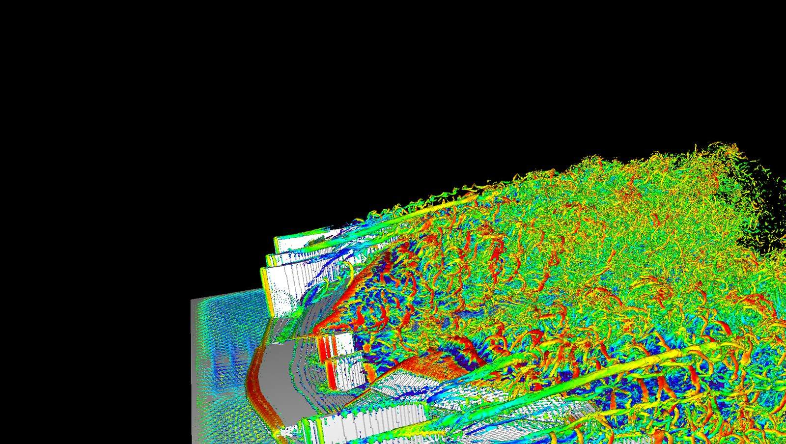
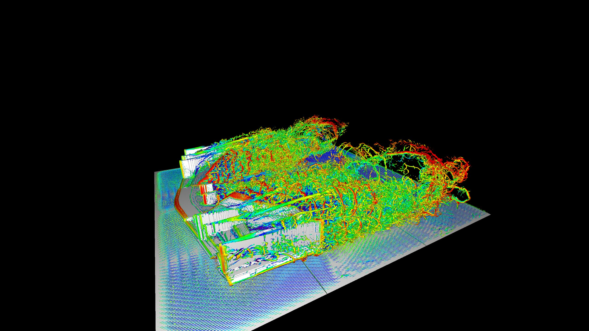

# OpenFOAM (RANS) vs FluidX3D (lattice Boltzmann) on the PERRINN front wing

*FluidX3D render of the PERRINN 2017 front wing in ground effect: about 154 million cells of 2.55 mm, RTX 3080.
The pictures are what lattice Boltzmann is good at. The numbers below show where it falls short for this job.*

## The short version

The same wing, at the same ride height and speed, was run through the pipeline's OpenFOAM setup and through
[FluidX3D](https://github.com/ProjectPhysX/FluidX3D), a GPU lattice Boltzmann solver.

| | OpenFOAM, SA RANS (pipeline baseline) | FluidX3D, LBM + Smagorinsky LES | Difference |
|---|---|---|---|
| Cl (full wing, Aref 1 m², downforce negative) | **-1.134** | **-0.218** | 81% less downforce |
| Cd | **0.212** | **0.224** | 5% more drag |
| Downforce at 50 m/s | 1,736 N | 334 N | |
| Cells | 6.75 M, half wing | 132.4 M (657 x 819 x 246), full wing | |
| Smallest cell at the wing | 0.8 mm (edges), 3.1 mm (flat), 0.4 mm wall layer | 6.1 mm everywhere | about 8x coarser at the edges |
| Domain (length x width x height) | 9.7 x 5.0 x 2.5 m (half meshed, mirrored) | 5.0 x 4.0 x 1.5 m | |
| Flow | steady (500 iterations) | unsteady, averaged over the last 0.15 s of 0.3 s | |
| Hardware and time | 14 CPU cores: mesh 23 min + solve 64 min | 1 GPU (RTX 3080 10 GB): 15 min (894 s) for 0.3 s of flow | |

There is no wind-tunnel data for this wing, so this shows how far apart the two methods are, not which one is
right. The OpenFOAM result is mesh-independent to about 1% (fine-mesh Cl -1.093, coarse -1.013), and the pipeline's
SA setup was within 8% of measured downforce on the Zerihan wing, so the RANS number is the one to trust here.

## A second run: the half wing

The OpenFOAM baseline meshes half the wing, so a second FluidX3D run did the same: the half wing against a wall at
the centreline, in a box half as wide. Half the width for the same memory gave finer cells.

| | OpenFOAM, SA (baseline) | FluidX3D, full wing | FluidX3D, half wing |
|---|---|---|---|
| Cell size at the wing | 0.8 mm (edges), 3.1 mm (flat), 0.4 mm wall layer | 6.09 mm | 4.83 mm |
| Cells | 6.75 M | 132.4 M (657 x 819 x 246) | 132.8 M (414 x 1035 x 310) |
| Box (width x length x height) | 9.7 x 5.0 x 2.5 m (half meshed) | 4.0 x 5.0 x 1.5 m | 2.0 x 5.0 x 1.5 m |
| Cl (full-wing value, downforce negative) | -1.134 | -0.218 | -0.263 |
| Cd | 0.212 | 0.224 | 0.361 |
| Cl/Cd | 5.35 | 0.98 | 0.73 |
| Downforce, drag at 50 m/s | 1,736 N, 325 N | 334 N, 342 N | 402 N, 553 N |
| Swing in the averaging window (peak to peak) | steady | Cl 0.055, Cd 0.069 | Cl 0.037, Cd 0.071 |
| Time | about 87 min on 14 CPU cores | 894 s | 1,420 s |

Against OpenFOAM the half wing has 77% less downforce and 70% more drag. Two things stand out:

- **Downforce stays far too low.** It rose 20% from the first run to the second, but the runs differ in cell size, box
  width and the centreline wall, so that change cannot be put down to the cells alone.
- **Drag rose 62% (0.224 to 0.361), and that is not explained.** The candidates, none of them tested: slot gaps and
  trailing edges still too coarse, the moving centreline wall standing in for a true symmetry plane (FluidX3D has no
  symmetry boundary), and 0.15 s of averaging being too short for an unsteady flow. Each result is a single run, and
  the forces swing by 14 to 31% of their means.

## Why the downforce collapses (the downsides of the method for this job)

- **Uniform cells cannot resolve a multi-element wing.** LBM uses one cell size everywhere, so the size is set by
  the GPU's memory. At about 6 mm, the slot gaps between the flaps and the thin trailing edges are one cell or less:
  the slots close up and the flaps stop working as separate elements. OpenFOAM put 0.8 mm cells on the same edges.
  The pipeline's own design-variant runs point the same way: the wing with only two elements gives Cl -0.32, three
  elements -0.75, the full wing -1.13. FluidX3D's -0.22 looks like a wing whose flaps are not working.
- **No wall model.** The boundary layer is far thinner than one cell, and FluidX3D has no wall function to make up
  for it. Its own Ahmed-body example warns that drag comes out 1.3-2x too high for this reason. In the first run the
  drag landed within 5% of RANS, but the finer half-wing run (below) came out 70% higher, so that agreement was a
  coincidence, not a sign of skill.
- **Staircase surfaces.** The wing is turned into cubes. Curved surfaces become steps of one cell, which matters
  most at leading edges and on the highly curved flaps.
- **Memory limits the box.** The force field needs about 12 more bytes per cell, so the box had to shrink to
  4 x 5 x 1.5 m to keep cells at 6 mm. The walls are closer than in the OpenFOAM case (1.2 m above the wing instead of
  2.2 m, 1.1 m beside each endplate instead of 1.6 m), which adds some blockage.
- **It needs averaging.** The flow is resolved in time, so forces swing from sample to sample (peak-to-peak 0.055 in Cl and 0.069 in Cd here) and
  need a long, averaged run. Steady RANS gives one settled number.

What it does well: it is fast (a 132-million-cell transient run in 15 minutes on one consumer GPU), it needs no
meshing, so dirty geometry is less of a problem, and it shows unsteady wake structures that steady RANS averages away.
For pictures and quick flow exploration it is excellent. For downforce on a multi-element wing, at the resolution a
10 GB GPU allows, it is not usable, and that is why the pipeline uses OpenFOAM.

## What had to change to make the comparison fair

FluidX3D is not a drop-in replacement, so each difference from the pipeline's setup was matched or noted:

| Topic | OpenFOAM pipeline | What was done in FluidX3D |
|---|---|---|
| Geometry | `perrinn_front_wing.stl`, metres, flow +x, ground at z = 0 | Same STL, rotated by `fluidx3d/wing_to_fluidx3d.py` because FluidX3D blows along +y. Ride height (85.6 mm) and rake (0.495°) unchanged. FluidX3D only reads binary STL, which the pipeline already writes. |
| Half or full model | Half wing with a symmetry plane; Aref halved so coefficients are full-wing values | Full wing: FluidX3D has no symmetry boundary. Compared on Cl and Cd, which are full-wing in both. |
| Speed, air, Reynolds | 50 m/s, ν 1.5e-5 m²/s, Re 2.46 M on the 0.737 m chord | 50 m/s, ρ 1.225 kg/m³, ν 1.48e-5 m²/s, Re 2.49 M (1% apart). Lattice speed 0.075 mapped to 50 m/s with `units.set_m_kg_s`. |
| Ground | Moving wall at 50 m/s | Floor cells marked solid and given a velocity of 50 m/s (`MOVING_BOUNDARIES`). |
| Inlet, outlet, sides | Velocity inlet, pressure outlet, far-field sides and top | Equilibrium boundaries (`EQUILIBRIUM_BOUNDARIES`) on all five sides, fixed to the free-stream velocity. |
| Turbulence | Spalart-Allmaras RANS, fully turbulent inflow, one wall layer (0.4 mm) | Smagorinsky-Lilly LES (`SUBGRID`), uniform laminar inflow, no wall model. |
| Measuring the force | `forceCoeffs` on the wing patch | `FORCE_FIELD` switched on; the wing voxelized as `TYPE_S` plus `TYPE_X` so `lbm.object_force(TYPE_S\|TYPE_X)` sums the wing only, not the moving floor. Drag is the +y force, lift the +z force, converted to newtons with `units.si_F`. |
| Convergence | Mean over the last 100 of 500 iterations | 0.3 s simulated (3 passes of the air through the box); mean and peak-to-peak over the last 0.15 s, sampled every 50 steps. |
| Outputs | `results.json`, `summary.md` | `forces.csv` (history) and `results.json` (means, swing, cell size, run time), written by the setup. |

The GPU also needed two workarounds that have nothing to do with the physics:

- **Driver buffer limit.** NVIDIA's OpenCL driver allows one memory buffer of at most a quarter of the card's memory
  (2,559 MB on a 10 GB RTX 3080). The simulation is split into three domains on the same GPU
  (`LBM lbm(N, 1u, 3u, 1u, nu)`) so each buffer fits.
- **Host memory.** FluidX3D keeps a copy of the fields in system RAM, and the force field adds more. With WSL also
  holding memory, the first attempt failed with `bad_alloc`; `wsl --shutdown` before the run fixed it.

## What was changed in FluidX3D's own files

FluidX3D was built from the upstream repository at commit `b85d64e` ("Updated driver install instructions").
Three of its files differ from that commit in substance (the other files Git lists as modified differ only in
Windows line endings):

| File | What changed | What it is for |
|---|---|---|
| `src/setup.cpp` | Three `main_setup()` functions added at the top: 156 lines added and 2 removed, in three places. The exact diff is [`fluidx3d/setup.cpp.patch`](fluidx3d/setup.cpp.patch) | the force run (the RANS comparison) and the two renders; see below |
| `src/defines.hpp` | `BENCHMARK` switched off (while it is on, it replaces every set-up with the benchmark); `FORCE_FIELD`, `EQUILIBRIUM_BOUNDARIES`, `MOVING_BOUNDARIES` and `SUBGRID` switched on; offline frame size 1920 x 1080 changed to 3840 x 2160. `FP16S` is already on upstream | the first four are needed by the force run; the frame size is for the renders |
| `FluidX3D.vcxproj` | Visual Studio toolset `v142` changed to `v145` | building with the installed Visual Studio; nothing to do with the physics |

The patch applies to that commit's `setup.cpp` with `patch -p1 < setup.cpp.patch`. Tested: the result is identical to
the edited file, apart from Windows line endings.

### The three set-ups in `setup.cpp`

Only one `main_setup()` can be active. The active one starts with `/**/void main_setup()`; the other two start with
`/*void main_setup()`, so they are commented out. To switch, put `/**/` on the one you want and `/*` on the one you
are leaving. The two renders need `GRAPHICS` or `INTERACTIVE_GRAPHICS` in `defines.hpp`; the force run does not
(it runs faster without).

| Set-up | State | File here | Used for |
|---|---|---|---|
| Front wing, force measurement | active | [`setup_forces.cpp`](fluidx3d/setup_forces.cpp) | **The RANS comparison.** The two force runs above; `half_model = false` is the full-wing run, `true` the half-wing run |
| Front wing, render | commented out | [`setup_render.cpp`](fluidx3d/setup_render.cpp) | The wing video and still, in a tight box |
| Whole car, render | commented out | [`setup_car.cpp`](fluidx3d/setup_car.cpp) | The whole-car picture below |

The upstream Taylor-Green example below them has its comment markers moved onto their own lines. The behaviour is the same.

What the force-measurement set-up does that a stock FluidX3D example does not, and why each piece matters for a fair
comparison with the OpenFOAM job (the table further up gives the matched settings):

| Piece in `main_setup()` | What it does | Why |
|---|---|---|
| `units.set_m_kg_s(...)` and the box size in metres | Ties lattice units to metres, kilograms and seconds (lattice speed 0.075 is 50 m/s, density 1 is 1.225 kg/m³) | Forces come out in newtons, and the Reynolds number is 2.49 M, near the OpenFOAM 2.46 M |
| `read_stl(...perrinn_front_wing_fx.stl..., offset)` | Places the wing with its leading edge 1.5 m from the inlet and the ground at the floor, ride height untouched | Same ride height and rake as the OpenFOAM job |
| `voxelize_mesh_on_device(mesh, TYPE_S\|TYPE_X)` | Marks the wing as solid and also as `TYPE_X` | `object_force(TYPE_S\|TYPE_X)` then sums the force on the wing only; the moving floor is `TYPE_S` alone, so its force is left out |
| `if(!(flags[n]&TYPE_S)) u.y[n] = lbm_u` | Starts the air at the inflow speed but never sets a velocity on wing cells | A velocity on a solid cell makes it a moving wall |
| `z==0` cells solid with velocity `lbm_u` | Moving ground at 50 m/s | OpenFOAM uses a moving wall at 50 m/s |
| `TYPE_E` on the remaining faces | Equilibrium boundaries fixed to the free stream | Inlet, outlet, side and top faces as far-field (in the half model the centreline face is the wall instead) |
| `half_model` | Half wing placed on the `x == 0` wall, which is solid and moves at 50 m/s with the air; box half as wide; reference area halved | FluidX3D has no symmetry boundary, so this stands in for the symmetry plane of the OpenFOAM half model; Cl and Cd are still full-wing values |
| `LBM lbm(lbm_N, 1u, 3u, 1u, nu)` | Splits the box into three domains along y on one GPU | Keeps each memory buffer under the NVIDIA driver's limit |
| Loop with `lbm.run(50)` then `object_force(...)` | Reads the force on the wing every 50 steps and writes `t, side force, drag, lift, Cd, Cl` to `forces.csv` | Gives the force history, so the swing is visible and not just a mean |
| Averaging window | Averages Cd and Cl over the last 0.15 s of 0.3 s and records the peak-to-peak swing | One settled number to set against steady RANS |
| `results.json` | Writes the means, swing, cell size, grid, box, Reynolds number and run time | Every run is documented in a file, not in memory |

To repeat a force run: rotate the pipeline's wing STL with `python comparison/fluidx3d/wing_to_fluidx3d.py
perrinn_front_wing.stl perrinn_front_wing_fx.stl` and put the result in FluidX3D's `stl/` folder; apply the patch (or
paste `setup_forces.cpp` over the active function) and set `half_model`; check the `defines.hpp` switches above; build
Release x64; run `bin/FluidX3D.exe`. Results are written to `bin/forces/` (full wing) or `bin/forces_half/` (half wing).
Close WSL first (`wsl --shutdown`), as it competes for system memory.

## Whole car (pictures only)

*FluidX3D render of the whole PERRINN car: vortex structures (Q-criterion) coloured by velocity over a moving ground.
Made with [`setup_car.cpp`](fluidx3d/setup_car.cpp): 116 parts (one STL each, made by `src/step_to_fluidx3d.py` and voxelised
one at a time so that overlapping parts do not cancel), in a 5.0 x 14 x 2.75 m box, Reynolds number 1 million on the
5.38 m car length.*

This is a picture, not a result. No forces were taken from the car run and it was not compared with OpenFOAM. The
same limits apply as for the wing: uniform cells and no wall model.

## What would make this comparison fairer

- **FluidX3D on the Zerihan single-element wing**, where wind-tunnel measurements exist, to separate the method's limits
  from the too-coarse slots on a multi-element wing.
- **A DDES run in OpenFOAM**, so that the OpenFOAM side is also unsteady. See "Planned" in the
  [main README](../README.md#planned).

## Files

| File | What it is |
|---|---|
| `openfoam/` | `results.json`, `summary.md` and `job.json` of the baseline job `perrinn_fw_sa_half` (run 2026-11-07) |
| `fluidx3d/setup.cpp.patch` | Every change to FluidX3D's `src/setup.cpp`, as a diff against upstream commit `b85d64e` |
| `fluidx3d/setup_forces.cpp` | FluidX3D `main_setup()` for the force measurement, with the `half_model` switch (paste into FluidX3D's `src/setup.cpp`) |
| `fluidx3d/setup_render.cpp` | FluidX3D `main_setup()` for the wing video (tight 2.2 x 2.35 x 0.5 m box, 2.55 mm cells, 4K frames) |
| `fluidx3d/setup_car.cpp` | FluidX3D `main_setup()` for the whole-car picture |
| `fluidx3d/wing_to_fluidx3d.py` | Rotates a pipeline STL into FluidX3D's frame |
| `fluidx3d/results.json`, `fluidx3d/forces.csv` | Full-wing run: the averages, and the force history every 50 steps (written by the earlier version of the set-up: the drag and downforce keys are `drag_mean_N` and `downforce_mean_N`) |
| `fluidx3d/results_half.json`, `fluidx3d/forces_half.csv` | The same for the half-wing run |
| `fluidx3d_front_wing.jpg`, `fluidx3d_full_car.jpg` | The two pictures on this page |

FluidX3D itself is not included; it has its own licence (non-commercial use).
