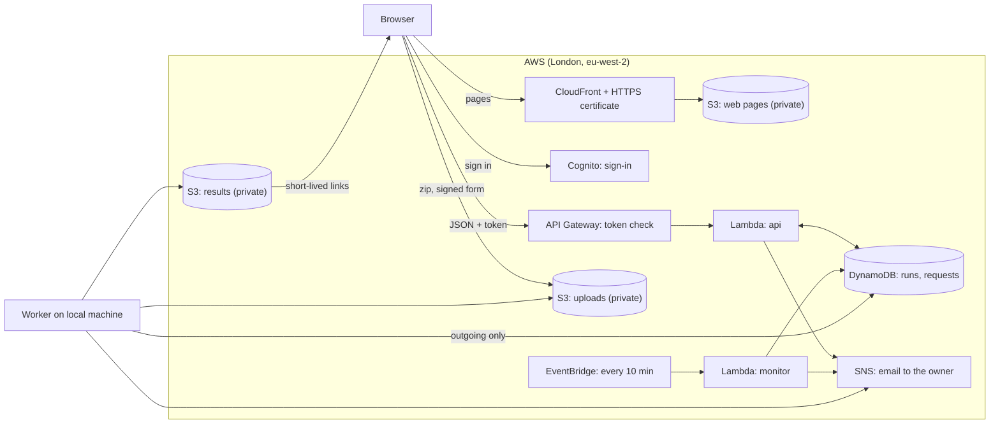
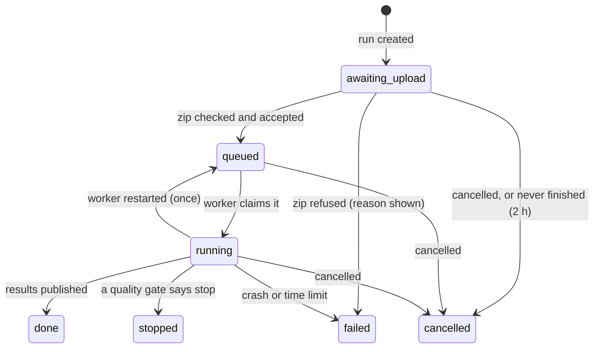
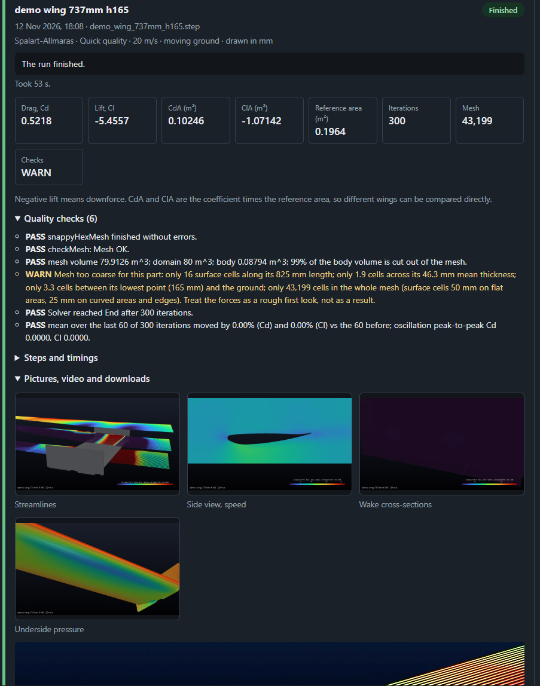

# The website: how it is built and deployed

[← Back to the main README](../README.md)

`cfd.samuelojo.tech` is a private front end for the pipeline. People the owner approves sign in, upload up to
five STEP wings at a time, watch each run's progress during the day and read the results (numbers, pictures,
video). The simulations themselves run on the owner's own PC, not in the cloud. Everything in the cloud is
described as code in [`aws/terraform/`](../aws/terraform), and the whole thing is built with the same rule as the
pipeline: it checks before it trusts, and anything that goes wrong is reported rather than hidden.

## Status

| Stage | What it adds | State |
|---|---|---|
| 1 | HTTPS site, private hosting, invite-only sign-in | **Live** at https://cfd.samuelojo.tech since 12 Nov 2026 |
| 2 | Access requests, upload of 1 to 5 wings, queue, home-PC worker, live progress, results page, email alerts | **Live**, with one real run through it on 12 Nov 2026 (see [the first run](#the-first-real-run-stage-2-12-nov-2026)) |

Sections below say which stage they describe. The words *validated* and *verified* keep their strict meaning from
the main README (comparison with measurements, and numerics checked). Neither applies to the website: it is
*tested*, and the list of what the tests do not cover is under [Testing](#testing).

## Five design decisions

1. **Invite-only.** Nobody can sign themselves up. A visitor fills in a request form; the owner is emailed and
   approves with one command, which creates the account and has Cognito email a temporary password. A shared
   default password was rejected: it lets whoever guesses an email address sign in first.
2. **The simulations run at home.** The PC and its GPU are already owned, so there is no cloud compute bill. AWS
   holds only the web pages, the queue, the uploaded files and the results. The PC makes outgoing connections only
   and asks AWS for work every 15 seconds; nothing is opened on the home network, and no run starts while the
   worker program is closed.
3. **Everything is code.** Terraform defines every cloud resource, so the whole site can be rebuilt, reviewed in a
   pull request and torn down. The access key for the home PC is the one deliberate exception (see
   [Security](#security)).
4. **Every upload is checked three times**, by the browser, the API and the worker, because the file arrives from
   the internet and ends up in a program that runs on a home PC.
5. **If anything fails, the owner is emailed.** A failed run, a quality-gate stop, a silent worker, a crashed
   function: each becomes an email, and repeats are limited so a long outage is one message.

## Architecture



| Piece | Service | Why |
|---|---|---|
| Pages | S3 (private) behind CloudFront, ACM certificate, Route 53 records | Only CloudFront can read the bucket; HTTPS only; the site name is a record in the existing `samuelojo.tech` zone |
| Sign-in | Cognito user pool | No passwords stored by this project; 12-character passwords, optional authenticator-app two-factor, reset by email, deletion protection on |
| API | API Gateway (HTTP API) with a Cognito token check, two Python 3.12 Lambda functions | Pay per request, idle most of the day; the gateway rejects calls with no valid token before any code runs |
| Runs and requests | DynamoDB, on-demand billing, point-in-time recovery | One table of runs (indexed by user and by status) and one of access requests |
| Files | Two private S3 buckets, encrypted, HTTPS-only, with expiry | Uploads (14 days) and results (90 days); the browser uploads straight to S3 with a signed form, so large files never pass through a Lambda |
| Health checks | EventBridge every 10 minutes, a second Lambda | Looks for a queue waiting on a silent worker, a run that stopped reporting, and abandoned uploads |
| Alerts | SNS email topic, CloudWatch alarms | Every alert to the owner arrives through one topic |
| The worker | `aws/worker/worker.py` on the local machine, signing in as a restricted IAM user | Claims runs, runs the pipeline, reports progress, uploads results |

## A run's life (stage 2)



1. The visitor chooses 1 to 5 files. The browser checks each starts like a STEP file, zips it, and asks the API
   to create one run per wing.
2. The API returns a signed upload form per wing (valid 15 minutes, size-limited). The browser posts each zip
   straight to S3, then tells the API, which re-reads the zip's directory in S3 and either queues the run or
   fails it with the reason.
3. The worker claims the oldest queued run with a conditional write (two workers could never take the same one),
   unpacks the STEP file to a fixed path, builds the job file from re-checked options only, and runs
   `src/run_job.py` with a time limit.
4. While it runs, the worker copies the stage, cell count and iteration count to the run's record every few
   seconds. The page polls every 8 seconds and shows the checklist, so people can watch during the day or come
   back later.
5. The worker makes pictures and the 360-degree video with ParaView, zips the results, uploads them, and marks
   the run done, stopped or failed. Runs are taken in the order created, and wings from one upload in the order
   they were chosen.

## Deployment

### What Terraform manages

| File | Contents |
|---|---|
| [`versions.tf`](../aws/terraform/versions.tf), [`variables.tf`](../aws/terraform/variables.tf), [`outputs.tf`](../aws/terraform/outputs.tf) | Providers (AWS, and `archive` to zip the Lambda code), settings with checks (owner email, size and quota limits), and the names the worker and admin tool read back |
| [`dns_cert.tf`](../aws/terraform/dns_cert.tf) | The certificate (us-east-1, validated through DNS) and the `cfd.` A and AAAA records |
| [`site.tf`](../aws/terraform/site.tf) | The private pages bucket, CloudFront, the security-headers policy, the page files and the generated `config.js` |
| [`auth.tf`](../aws/terraform/auth.tf) | The Cognito user pool and web client |
| [`storage.tf`](../aws/terraform/storage.tf), [`database.tf`](../aws/terraform/database.tf) | Upload and results buckets; the two DynamoDB tables |
| [`api.tf`](../aws/terraform/api.tf) | The Lambda functions, the HTTP API and its token check, throttling, the 10-minute schedule |
| [`notify.tf`](../aws/terraform/notify.tf), [`worker.tf`](../aws/terraform/worker.tf) | The alert topic and alarms; the worker's restricted IAM user |

### Deploying from nothing

Needs an AWS identity that is not the root user, Terraform 1.6 or newer and the AWS CLI. The full operating
instructions, including the worker, are in [`aws/README.md`](../aws/README.md); in outline:

```bash
cd aws/terraform
cp terraform.tfvars.example terraform.tfvars    # then set owner_email (git ignores this file)
terraform init -upgrade
terraform validate
terraform plan                                  # read it before applying
terraform apply
```

Then, by hand: confirm the alert subscription (AWS emails a link once), clear the CloudFront cache, create the
worker's access key with the AWS CLI and store it as a named profile, and run the worker's own `--check`.

### Shipping a change

Edit a file under `aws/web/` or `aws/lambda/`, then `terraform apply`: Terraform notices the changed file (by its
MD5), uploads only that, and re-zips the Lambda code. For page changes also clear the CloudFront cache, which
otherwise serves the old page for up to five minutes.

### What the first deployment looked like (stage 1, 12 Nov 2026)

This is the real sequence, including the one error, because plans rarely survive contact with a cloud provider.

- `terraform validate` passed. The first `plan` was **19 to add, 0 to change, 0 to destroy**, and the only thing
  it did to the existing DNS zone was add three records for the `cfd.` name.
- The first `apply` stopped at the Cognito user pool: Cognito rejects an invitation template that has no
  text-message part, even though email is the only delivery method used. Adding a (never sent) `sms_message` fixed
  it. Everything created before the error stayed in Terraform's state, and the second apply added the last three
  resources.
- The site then answered HTTP 200 through a London CloudFront edge, and the live response carried all five
  security headers (HSTS, the content-security policy, no framing, no referrer, no content sniffing).
- The first account was created with the AWS CLI; the emailed temporary password, the forced password change and
  the sign-in all worked.
- A later change (a "show password" tick box) shipped the way described above: `terraform apply` showed the
  three expected file changes, and the cache was cleared.

### The first real run (stage 2, 12 Nov 2026)

Stage 2's first plan was **45 to add, 5 to change, 0 to destroy**. Reading the Lambda code against its IAM policy
found one missing permission: the API's existence check on an uploaded file needs `s3:ListBucket`, or S3 answers
"forbidden" instead of "not found". It was added to `api.tf`. The first run then went through the site with the
worker on the PC.



*A rough test, to show the pipeline working. Take the numbers with a pinch of salt.* The run was a 737 mm wing,
half-domain, Spalart-Allmaras, the quick preset, 20 m/s, moving ground. It took 53 seconds: 43,199 cells, Cd 0.5218,
Cl -5.4557, all mesh and solver gates passing and the resolution gate warning that the mesh is too coarse for the part
(16 surface cells along the length, 1.9 across the thickness). The forces were converged to six digits, so the
warning is about mesh error, not convergence. All five pictures and the orbit video were made. Two things the run
showed: the wake-slice picture is almost blank, and the page labelled the preset "Quick", which suggested more than
it delivered, so the site now calls it Preview and puts a caution above the numbers of any Preview run.

## Security

| Threat | What stops it |
|---|---|
| Reading private data from the internet | All three buckets block public access, require HTTPS and encrypt at rest; the pages bucket is readable only by CloudFront; results are served through links that expire after 15 minutes |
| Strangers creating accounts | Cognito sign-up is off; the owner creates each account; passwords need 12 characters with all four character types; temporary passwords expire after 7 days; optional authenticator-app two-factor |
| Script injection | A strict content-security policy (scripts and styles only from the site itself, connections only to Cognito, the API and the two buckets), no inline script, no third-party script, and the page is built with `textContent`, never `innerHTML`; HSTS, no framing, no referrer |
| One user reading another's runs | Every run route checks the owner, and someone else's run looks like a missing one |
| Hostile or oversized uploads | The signed upload form limits the size and expires; the API checks that the object is a real zip with exactly one STEP file, not encrypted, not a zip bomb (compression ratio above 200 is refused) and no larger than 100 MB unpacked; the worker repeats the check before unpacking to a fixed path, so a hostile file name cannot place a file elsewhere |
| Abuse of the public request form | A hidden field that only robots fill in, throttling (1 request a second, burst 3), repeat requests do nothing and send no second email, and the answer is the same whether or not the address is known |
| Leaked cloud credentials | The root user has no access keys and has two-factor on. The worker signs in as its own IAM user, which can update run records, read uploads, write results and send alerts, and nothing else (it cannot delete). Its key is created by hand so the secret never enters Terraform's state file, and the pipeline is started without any `AWS_*` variables |
| Runaway use | Per-person quotas (10 unfinished runs, 20 new runs a day), a 240-minute limit per run, on-demand billing, expiring files, 30-day log retention |

**Known limits.** The worker runs jobs as the owner's Linux user, so a deliberately hostile STEP file would meet the
owner's permissions. That is acceptable for a team and for people the owner has vetted, not for the open internet; the
fix is to run the worker as a separate, unprivileged user, which is not set up yet. The password goes to Cognito
over HTTPS with `USER_PASSWORD_AUTH` (SRP is a later upgrade). Cognito's built-in email is limited to about 50
messages a day, so Amazon SES is needed before opening the site up. There is no screen for enrolling an
authenticator app yet. Terraform's state file is local and git-ignored; it should move to an S3 backend with
locking before anyone else works on this.

## What reaches the owner's inbox

Every alert is an email from one SNS topic, with a subject starting `[CFD site]`.

| Email | When |
|---|---|
| Access request | Someone used the form; it carries the approve and reject commands |
| Run failed / stopped by a quality check / finished with a FAIL check / pictures failed | The run's own outcome |
| Worker offline | Runs have waited over 10 minutes and the worker has been silent over 5 |
| Run not reporting | A run has sent no update for 30 minutes (the worker probably died) |
| The site's API hit an error | An unexpected error in the API code |
| CloudWatch alarm | A Lambda function crashed outright |

## Testing

`python -m pytest aws/tests` runs 114 tests (the browser tests skip themselves where Playwright is not installed):

| Tests | What they cover |
|---|---|
| 34 + 18 + 3 + 6 | The shared rules, the API, the health check and the admin tool, run against in-memory stand-ins for DynamoDB, S3 and SNS. The stand-in table rejects floats and any call shape the code does not use, as the real service would |
| 31 | The worker, with a fake pipeline and fake ParaView: a good run, a FAIL gate, a stop by the mesh-resolution check, a crash, a timeout, a cancel, a restart, the unpack size cap, folder cleanup, two workers racing for one run, a picture step that draws only some of its scenes, and the conversion of Linux paths to the Windows form ParaView needs |
| 10 | The browser's zip maker, read back with Python's zip reader, `unzip` and the server's own check |
| 12 | The real pages in headless Chromium under the production content-security policy (read from `site.tf`), talking to the real API code: sign-in, access request, a five-wing upload, live progress, results, the Standard default and the Preview and coarse-mesh cautions, cancelling, sign-out, token renewal, an expired session, phone and dark-mode layouts |

Breaking the code on purpose (mutation checks) confirmed that the important tests fail when they should. The tests
also found real bugs before any user could: the worker did not publish its final stage and counts, a ready-made
zip was uploaded empty once the file picker was cleared, wings created in the same second could swap queue order
between polls, and the previous user's email stayed in the hidden page after sign-out. Running the suite on a
second machine found two faults in the tests themselves: one wrote to a folder that existed only on the machine they
were written on, and one behaved differently where WSL's `wslpath` command exists. Both were fixed, and the suite now
gives the same result with and without `wslpath`.

**What one real run settled (12 Nov 2026):** the stage 2 plan and apply; the real DynamoDB updates and the S3
signed upload with its CORS rules; the API Gateway token check with a real Cognito token; and the worker driving real
OpenFOAM and the Windows ParaView from WSL. **Still untested on the real services:** failure and cancel paths, the
alert emails (including the worker-offline alert), the access-request form, more than one user, and H.264 video
playback in a particular browser. These ran only against the stand-ins described above.

## Limits and cost

| Limit | Default |
|---|---|
| Wings per upload | 5 |
| Zip size, and unpacked STEP size | 100 MB each |
| Unfinished runs per person; new runs per 24 hours | 10; 20 |
| Uploads kept; results kept | 14 days; 90 days |

All of these are variables in [`variables.tf`](../aws/terraform/variables.tf). Every service is pay-per-use and idle
most of the time, so the cost should be small and is dominated by stored results and large downloads; a monthly
AWS budget alarm is recommended and is not part of the Terraform.

## Next

A Standard-quality run of the same wing, to measure how far the first-look numbers move; a fix for the blank wake
picture; the real-service tests listed above; run the worker as a separate Linux user; Amazon SES for email; an
authenticator-app enrolment screen; an S3 backend for Terraform state; FluidX3D as a third solver (already shown
on the page as "coming later").
